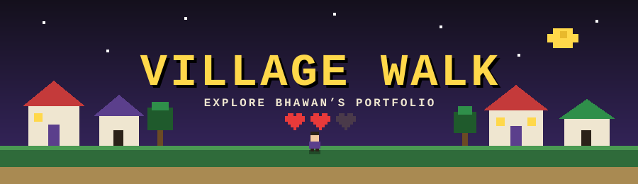

  

  
  
  
  

A tiny 16-bit style village you can walk around in, built with plain HTML, CSS and JavaScript on a single canvas. Talk to villagers, explore the map, and dodge the foes after dark.

- 🎮 Keyboard and on-screen touch controls
- 💬 Retro dialogue boxes and a heart-based HUD
- 🧭 AUTO mode that walks you to the next place

---

### 📜 License

**All Rights Reserved.** This project is a portfolio piece, shown for display and evaluation only.
Copying, forking, modifying, or reusing any part of it, commercially or personally, is not allowed without written permission. See [LICENSE](LICENSE).

© 2026 bhawan-kavinda

